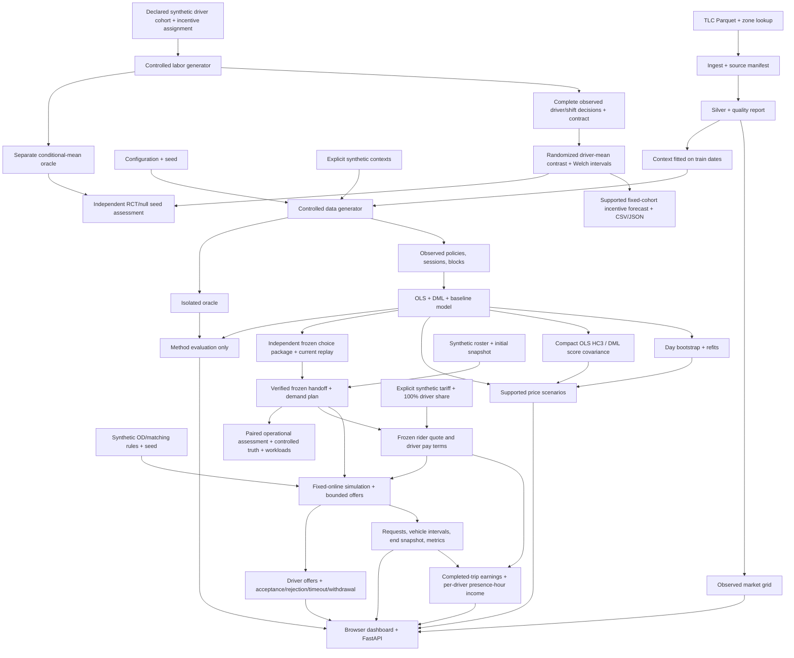
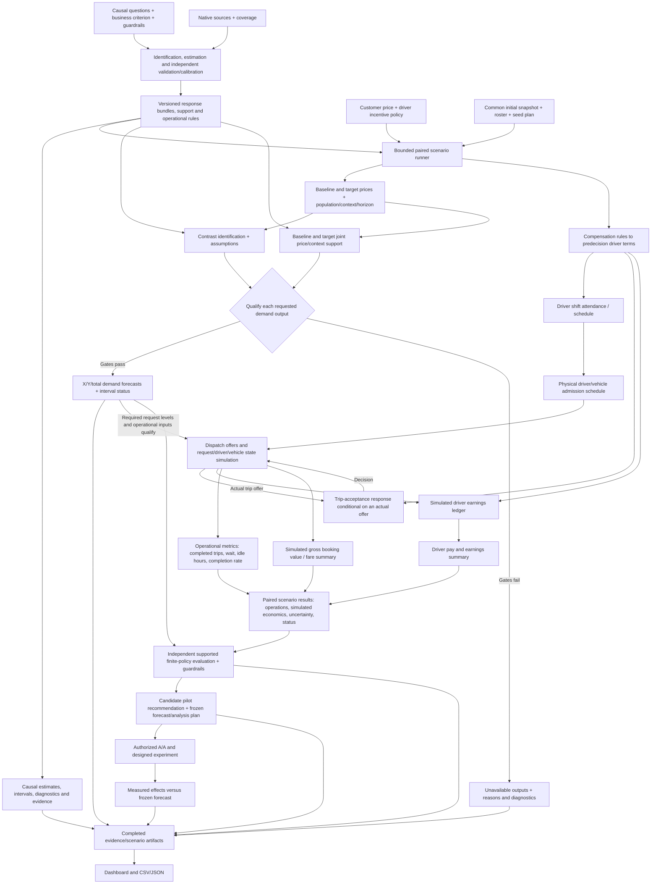

# Project architecture

The [unified proposal](reference/GSM_Causal_Marketplace_Proposal.md) owns the
problem, contribution and scope. This document maps them to data flow, boundaries
and artifacts; the current implemented flow remains distinct from target design.

```text
gsm-ride-hailing/
├── src/gsm_poc/              # Core application package
│   ├── core/                 # Shared configs, validators, and artifact lifecycle
│   ├── data/                 # Medallion data pipeline (ingest, silver, marts, context)
│   ├── causal/               # Econometrics, estimation, uncertainty, and scenarios
│   │   └── benchmarks/       # Discrete choice and policy benchmarks
│   ├── simulation/           # DGP generator, demand planning, and marketplace
│   ├── pipeline/             # Batch orchestration and stage execution
│   └── ui/                   # Browser dashboard, API and bounded worker processes
│       └── tabs/             # Operations, method checks, scenario explorer
├── configs/                  # TOML execution and experiment profiles
├── scripts/                  # Coverage evaluation runners and compute probes
├── tests/                    # Deterministic regression, unit, and integration tests
├── docs/                     # Specifications, contracts, and roadmap
│   ├── reference/            # Proposal and engine design reference docs
│   └── submission/           # Preserved reports and milestone evaluations
├── data/                     # Versioned artifacts (bronze, silver, gold, synthetic)
└── runs/                     # Execution runs, manifests, bundles, and diagnostics
```

## Current implemented flow

The [current PoC scope](WEEK3_POC_SCOPE.md), confirmed by Bun on 12 October 2026,
holds the online roster fixed and separates trip acceptance from labor supply.
Incentive-driven schedules and income feedback below are broader extensions;
the existing controlled supply branch is retained scientific evidence, not a
required simulator input. Version-3 operations implement individual offer refusal
without removing online drivers or multiplying physical hours by acceptance.

The following flow describes the current demand/choice PoC, independent controlled
offered-incentive estimation and fixed-roster simulator with optional minimal
compensation settlement and bounded individual offers. Synthetic acceptance is
declared independently of rider price; no GSM acceptance coefficient is fitted.
Physical behavioral schedules and the income-supply solver below describe the
broader research architecture. Supply assumptions, schemas and inference
follow [WEEK3_SUPPLY.md](WEEK3_SUPPLY.md).



## Boundaries

The generator may create oracle artifacts. Only the evaluator and method
verification tab may read them. The estimator receives the observed block table;
its encoder constructs W from a fixed allowlist. Scenarios use a fitted model
bundle and frozen held-out context, never oracle probabilities.
The supply estimator receives only complete observed driver decisions and the
observed contract, never generator truth. Its fixed randomized contrast has no
learned preprocessing or method selection; independent assessment uses new seeds.
Supply forecasts are expected responses, not physical vehicle schedules; there is
no automatic connection to the demand-plan/simulator until population/horizon and
feasible admission constraints qualify.

The optional compensation fixture uses Bun's approved assumption that drivers
receive 100% of the displayed app fare. Frozen quote and driver-pay terms precede
simulation; only completed trips settle earnings. The fixed roster includes drivers
with zero trips in presence-hour summaries. Financial continuations
require the same frozen context and settle only current-window completions.
Version-3 quote and driver-pay terms are immutable before offer decisions;
rejected, timed-out, withdrawn and pending offers earn no completion settlement.
These realized earnings do not identify a predecision income response or feed back
automatically into supply hours. See [compensation usage](USAGE.md#week-3-minimal-compensation).

TLC operational records have `source_kind=observed_tlc`. Offline simulations have
`source_kind=synthetic`; simulations using train-fitted TLC context have
`source_kind=semi_synthetic`. All simulated behavior has evidence level C.

Models are fitted in batch. UI controls do not train models, download raw data, or
launch Monte Carlo jobs. Joblib bundles are trusted local artifacts, not an upload
format. A completed manifest and artifact checksums gate dashboard loading.

## Storage and execution

Submission folders contain reports only. Archived research evidence lives in
`artifacts/research/<date>/`: frozen source copies, protocols, validation metadata,
tables, checksums and replay archives. Active code remains in `src/` and `scripts/`.
The [research archive index](../artifacts/research/README.md) records the layout
and the byte-preserving relocation from the former submission paths.

Tables use Parquet; metadata uses strict JSON; exchange outputs use CSV/JSON.
Every stage writes outputs atomically, records failure context, and reuses a result
only when input, source-code, configuration, and artifact hashes match. Run manifests
record code revision, configuration, data identity, seed, dependency lock hash,
Python/package versions, timings, and successful artifacts.

The CLI implements `ingest`, `build`, `generate`, `fit`, `evaluate`, `scenario`,
`freeze-choice`, `prepare-inference`, `prepare-demand`, `simulate-marketplace`,
`evaluate-marketplace`, the four controlled supply commands and `run-all`. Dataset and model run IDs
explicitly select dependent artifacts.
Synthetic mode can run without network access or TLC data. TLC mode never
substitutes synthetic trips for missing observed records.

`freeze-choice` copies every fitted estimator, effects, diagnostics, bootstrap
draws, splits, method metrics and the historical scenario into a separate verified
run. It preserves the original manifest bytes and training configuration/environment,
records the packaging environment separately and writes `choice_handoff.json`.
`current_scenario_result.json` replays the saved model and draws under current
validation rules without fitting or reading oracle data. The handoff reports
numeric agreement and current support/interval limitations independently of
historical statuses; packaging success does not establish reviewer acceptance.
Scenario and demand consumers use the original training support thresholds.

Choice `scenario()` and UI default to analytic individual intervals from compact
joint coefficient covariance; baseline uncertainty and cross-covariance propagate
through elasticity/scenario gradients. Bootstrap is selected explicitly and loaded
only on that inference path. Saved batch baseline/replay remains bootstrap.
`prepare-inference` derives a new package from an older freeze-choice, verifying
observed data hashes and point reconstruction before adding covariance sidecars;
original model/hand-off bytes and the Week 3 rate contract remain intact.
See the [accepted technical exception](submission/days/20261011/week2_hybrid_acceptance.md)
and [usage](USAGE.md#hybrid-choice-inference). Integrity scans still hash registered artifacts.

The demand bridge and fixed-supply simulator run in batch, using verified local
artifacts. They preserve the frozen choice scope, apply price effects once and
count the shared X/Y fleet once. The simulator uses explicit synthetic OD/matching
rules and static SOC. Recommended version 3 validates a fixed online roster for
the complete observation horizon, reserves vehicles during pending offers and
resolves one seeded decision per driver/request pair. Request expiry/cancellation
withdraws pending offers; refusal leaves drivers online. Consecutive windows
preserve pending decisions, attempts, original deadlines and immutable financial
terms, alongside arrivals, request history and vehicle activity. Aborted pickup
legs finish before vehicle release. Request/offer/state-time/ledger accounting is
checked per window. Legacy V1/V2 fixture shift constraints and immediate acceptance
remain separate controls. Supply response, charging and income equilibrium are
outside the current PoC; GSM calibration and full-chain uncertainty remain open.
The evaluator freezes supported baseline/target demand runs, rules, compensation,
protocol and source snapshots, then exports paired seed records, controlled-truth
checks and workloads. Its Monte Carlo intervals condition on the fitted demand;
they are not causal/full-chain intervals. Independent assessment and technical
checks passed for the scoped Week-3 PoC; see the
[12 October closeout](submission/days/20261012/week3_poc_closeout.md). The package
is ready for Bun's review; GSM/original research acceptance remains separate.
Execution instructions and artifact-reading guidance are in
[USAGE.md](USAGE.md).

## Target customer and driver architecture

The [core engine design](reference/CORE_ENGINE_DESIGN.md) owns the target
algorithms, estimands and validation rules. Extend the existing packages through
versioned interfaces rather than treating the current fixed-supply trajectory
as a complete price/incentive forecast.

The target delivery flow starts with identifying and estimating causal rider-price,
driver-labor-supply and own/cross-service responses, then supported policy forecasts,
independent decision evaluation and experimental reconciliation. Response estimates,
intervals, diagnostics, assumptions, support and evidence are publishable before
the full simulator is complete. Simulation supplies the operational translation
when the policy forecast requires it; its technical gates remain mandatory for
those outputs. Initial target scope is one cluster and two services.

**Demand forecast extension, 20 October 2026 — controlled implementation:** the
target flow below adds separate identification and support checks for the requested
baseline-to-target price contrast, following the
[contribution specification](reference/GSM_Causal_Marketplace_Proposal.md#demand-forecasting-contribution).
A joint price contrast may be estimable without every separate price coefficient;
this requires its own model assumptions and validation. It does not change the
default OLS/DML collinear-price rejection or previous acceptance evidence.
Opt in to `contrast_ols` using `configs/demand_contrast.toml`; the original
estimator list remains the default. The extension uses SVD-reduced adjusted OLS,
HC3/t covariance and rank-one observed-line support; numerical rules and assessment
scope are frozen in the [demand protocol](BENCHMARK.md#demand-contrast-assessment--frozen-protocol-20-october-2026).
General context-dependent price manifolds and rank-deficient DML remain outside v1.

| Package | Target responsibility |
|---|---|
| `data/` | Map native sources to validated quote, eligibility, shift, trip-offer, state and finance ledger tables; retain nonparticipants, zero outcomes and cost-source coverage |
| `causal/` | Independently validate demand/choice and labor responses; the proposed demand extension checks the requested price contrast separately from support and exports estimable contrasts, available matrix components, intervals/statuses and reasons for unavailable results; trip acceptance remains a separate dispatch response |
| `simulation/` | Apply compensation rules; construct physical driver/vehicle schedules; dispatch offers, resolve acceptance and operate the state simulator; produce individual earnings ledgers and bounded income-supply trials |
| `pipeline/` | Freeze compatible model/calibration/policy/snapshot and evaluation inputs; orchestrate bounded supported forecasts, paired baseline/target scenarios, uncertainty, independent finite-policy comparisons against confirmed business criteria/guardrails, frozen experimental forecasts and reconciliation |
| `core/` | Define shared contracts, units, versions, support/status checks, seeds, budgets and artifact lifecycle |
| `ui/` | Read completed scenario artifacts and expose the same values, evidence, limitations and statuses as headless execution and CSV/JSON |



Offline fitting and calibration precede scenario execution. A frozen model
version links the demand/choice, participation and acceptance bundles, calibration,
compensation rules, units, support and evidence. Scenario trials use those inputs;
they do not fit responses from their own simulated outcomes.

The opt-in demand checks retain separate identification and support
reports. Neither support nor residual price variation establishes a causal basis
without assignment or defensible observational assumptions. Passing one gate
cannot override failure of the other; unsupported or unidentified outputs remain
unavailable without blocking independent qualified outputs. A contrast alone does
not provide the baseline/target request rates needed by simulation: a compatible
baseline, exposure and valid service-level probabilities/rates must also qualify.
Fixed-quote forecasts retain that population; they do not become total-market
demand through the handoff. Demand-only evaluation does not require a simulator.

Customer prices and driver compensation are separate policy paths. A tariff
change affects offered driver pay only through an explicit compensation rule.
Predecision terms and information feed driver decisions; realized earnings are
ledger outcomes. Participation predicts who joins a shift and conditional hours;
the admission schedule enforces physical roster/shift constraints. Trip acceptance
models a decision after dispatch makes an eligible offer. Not receiving an offer
is not rejection, and rejection does not mechanically remove idle serviceable
hours. The shared X/Y fleet is counted once throughout.

The solver reconciles expected income, participation/serviceable hours and
simulated utilization under fixed compensation rules. Each trial restarts from
the same initial snapshot; iterations are not consecutive operating windows.
Per-trip pay divided by pickup/trip duration may describe an offer, but is not
shift-level expected income because it excludes idle time and offer opportunity.
Use the declared decision denominator and explicit failure/nonconvergence status.

The evaluation layer compares supported finite candidates with unchanged policy
against a business criterion and minimum worthwhile improvement confirmed before
final evaluation, with service-quality, driver-income and budget guardrails. Policy
selection uses development data and independent final evaluation; the same fitted
model must not select a candidate and serve as its sole evidence of value. A
recommendation identifies candidates for an authorized pilot, with evidence,
uncertainty and reasons for rejection or deferral; it does not deploy a policy.

Report causal demand/supply/substitution responses and, when operational inputs
qualify, completed trips, fill/completion rate, waiting, cancellation, idle
vehicle-hours, simulated booking value and driver earnings. Revenue, contribution
margin, profit and ROI retain separate definitions and require their respective
measurement/accounting coverage. Missing GSM inputs leave the affected outcome
`not_evaluated` with reasons, without blocking supported causal or operational
outputs. Booking value or improved fulfillment does not establish profit/ROI.
Separate statistical intervals from Monte Carlo variability and sensitivity to
unmeasured assumptions. The experiment handoff freezes model/policy/assignment
references, forecasts and analysis before treatment outcomes; reconciliation
compares measured causal effects at matching scope and horizon without overwriting
the forecast. A/A and impact evaluation depend on actual data and authorization.

The initial demand mode remains `reduced_form_policy`: do not apply simulated
wait/ETA effects to booking again. A separately identified `structural_choice`
mode may add ETA/availability feedback later. Paired comparisons use a common
initial scope and seed plan, with independent replicates and uncertainty/evidence
statuses; a single trajectory is not an estimated policy effect.

## Research table schemas

This section owns the logical GSM table grains and the mapping/readiness
requirements below. These are proposed researcher-built schemas; implemented
tables are identified separately. [GSM_DATA_CONTRACT.md](GSM_DATA_CONTRACT.md)
owns native export requirements. Validate mappings before using these grains.

| Logical table | Grain/key | Content |
|---|---|---|
| `quote_session` | One session / `session_id` | Customer key, context, observation window, outcome/censoring |
| `quote_option` | One option per display/refresh / quote-set + quote + display-event key | Service, displayed/available, visible price/discount/ETA/position, policy version |
| `booking_event` | One native status event / source + event key | Request/booking/trip/session links, status/time, cancel actor/reason, retry/parent |
| `policy_assignment` | One assignment / assignment key | Unit/time, arm, offered/assigned/applied, probability/rule, exposure/override |
| `driver_shift_eligibility` | One eligible driver × decision window or shift opportunity / eligibility key | Eligible population including drivers receiving no offer/incentive and nonparticipants; contract/vehicle/service eligibility, effective periods, exposure/coverage and recorded participation or unknown outcome |
| `driver_offer_shift` | One shift offer/decision event / native decision key | Driver/shift/eligibility links, terms known before the shift decision, offered/received/accepted/declined/absent status and participation/hours outcome; distinct from trip dispatch |
| `driver_trip_offer` | One actual driver dispatch offer / source + offer key, linked to dispatch attempt | Request/driver/vehicle/shift, sent/received/deadline/response times, pending/accepted/rejected/timed_out/withdrawn status and observation coverage; immutable predecision displayed pay/conditions, known pickup/trip estimates, compensation/policy versions and source references |
| `driver_vehicle_state` | Native state event or constructed interval / source + event/interval key | Driver/vehicle/shift, zone, state/eligibility/SOC, gaps/coverage |
| `payment_cost` | One ledger item / source + native ledger key | Business links, customer fare payment or driver payout/bonus, funder/currency, rule version and period |
| `operational_event` | One dispatch/trip/charging event / source + native event key | Attempts/responses, timestamps/duration/distance, station/energy, matching version |
| `demand_block` | Zone × time block × service | Quote exposure, requests, conversion, pretreatment context, completeness |
| `baseline_snapshot` | One baseline window / snapshot version | Initial states, roster, request rates, calibration/rules, quality |

The controlled PoC currently writes `synthetic_policy_block`,
`synthetic_quote_session` and `choice_block` under `observed/`. The estimation
grain is zone × time block, with session counts and X/Y/NONE proportions.
These generated tables do not establish a mapping from GSM native schemas.

### Week 1 GSM mapping and readiness specification

The data contract requests eight source groups over the latest 12 months,
including relevant services, neighboring zones and controls. The researcher
records receipt, mapping and validation against the logical schemas above.

Track readiness separately for each source and mapping, retaining the evidence
reference, reason, owner and review date:

| Readiness state | Required evidence/meaning |
|---|---|
| `requested` | Source is listed in the request specification; receipt has not been assessed |
| `not_received` | No GSM export is available in the workspace; actual coverage remains unknown |
| `received_unmapped` | Native export and metadata are preserved with source identity/checksums; logical mapping is pending |
| `mapped_unvalidated` | Native-to-logical mapping is documented; grain, links, coverage and quality checks remain unvalidated |
| `validated` | Mapping and quality checks have recorded results for the declared source versions, population and time scope |

Source/field availability is a separate provider declaration. Use `not_recorded`
or `not_applicable` only with GSM confirmation and its reference; lack of receipt
or a missing field in an export remains unknown pending clarification. Mapping
validation does not establish causal identification, experimental evidence or
financial completeness.

The coverage checklist records GSM receipt evidence available in this workspace;
actual coverage has not been confirmed by GSM.

| GSM source group | Receipt status | Actual GSM coverage | Dependent GSM outputs |
|---|---|---|---|
| Booking & Demand | `not_received` | Unknown | Request funnel, completed trips, cancellations and operational outcomes |
| Pricing & Promotion | `not_received` | Unknown | Displayed/effective prices, promotion/subscription exposure and price-response estimates |
| Driver Supply & Status | `not_received` | Unknown | Eligible population, participation/hours, serviceable and idle vehicle-hours |
| Driver Earnings & Incentive | `not_received` | Unknown | Predecision offered terms, incentive response and reconciled driver earnings |
| Matching & Operations | `not_received` | Unknown | Conditional trip acceptance, dispatch/pickup timing and charging calibration |
| Customer Choice / Cross-service | `not_received` | Unknown | Observed choice sets, nonbooking, conversion and own/cross-service responses |
| Policy & Context | `not_received` | Unknown | Assignment/exposure checks, identification, support, interference and carryover |
| Finance & Cost | `not_received` | Unknown | Recognized revenue, contribution margin, incremental profit and ROI |

Preserve raw exports. Each mapping record connects native table/log, field and
schema/rule version to logical table/field, with the transformation and
original/normalized units.
It must retain:

- Source identity, dictionary/confirmation references, grain, primary/event keys,
  stable entity keys, retries/parents and source-to-logical lineage.
- Expected and observed join cardinality, unmatched/ambiguous links, as-of join
  rules, effective periods and predecision information cutoffs; nearest-time
  joins require uncertainty labels.
- Terms/information available at the decision time, separate from realized
  fare/pay and later outcomes. Reconstruction retains the applicable rule
  version, timestamped inputs, join provenance and reconstruction status;
  missing historical inputs leave terms unavailable, never replaced by realized
  earnings.
- Actual time/service/zone/population coverage, timezone, observation windows,
  retention/gaps and sampling rate; missing exposure/response or incomplete
  windows remain unknown rather than nonbooking, nonparticipation or rejection.
- Source, eligible, valid and excluded denominators with quality flags/reasons,
  duplicate/null checks and reconciliation results, separately for shift
  participation, dispatch exposure and trip acceptance conditional on an offer.
  Preserve nonbookers, nonparticipants, eligible nonrecipients, failed requests
  and zero-trip shifts; no trips does not establish offline state. Distinguish
  observed zero from missing, unknown and not applicable; unknown coverage and
  outcomes never become zero.
- Physical driver/vehicle keys and shared service eligibility for the
  state-time accounting defined in [artifact conventions](#artifact-conventions).

Source classifications and evidence follow [Boundaries](#boundaries). Existing
public/synthetic quality reports and manifests qualify only their declared
scopes; they do not fill the GSM receipt/mapping checklist. Missing/unvalidated
inputs follow the output-status rules in the
[target architecture](#target-customer-and-driver-architecture). Current progress
is indexed in [docs README](README.md).

## Artifact conventions

| Artifact | Current support | Content/convention |
|---|---|---|
| `demand_plan` | Implemented choice-to-request bridge | Zone/service, block start/end, requests/hour, model/source references, fixed quote exposure and support; baseline rates accompany target rates |
| `driver_response_bundle` | Proposed participation and acceptance interfaces | Separate participation/conditional-hours and offered-trip acceptance models, decision populations, predecision features, estimands, units, splits, support, diagnostics and evidence |
| `compensation_spec` | Minimal 100% fare-share fixture implemented; richer rules proposed | Explicit synthetic baseline X/Y fares, currency, fixed driver share and completed-only settlement; source/configuration/policy references. Fixed pay, bonuses and actual GSM rules remain unimplemented |
| `admission_plan` | Proposed physical supply interface | Eligible-population/model references, participation decisions, driver/vehicle/shift keys, shift start/end, service eligibility, roster reference, target and feasible serviceable hours, capacity gaps and compensation version |
| `driver_offers`, `offer_events` | Implemented V3 simulator decision trace | Offer/request/driver/vehicle/service keys, immutable predecision fare/pay/context and terms version; seeded one-draw decisions, response/resolution timestamps and accepted/rejected/timed-out/withdrawn/pending states. Current window includes newly offered and pending-at-start rows; transitions retain their own event times |
| `quote_terms`, `driver_pay_terms` | Implemented minimal compensation inputs | Separate frozen displayed fares and driver terms from tariff/policy; request/service keys, currency, rule references and completion-only payment condition. V3 terms precede actual individual offers |
| `earnings_ledger`, `driver_income`, `earnings_result` | Implemented minimal compensation outcomes | Completion settlement under frozen terms, zero earnings for cancellations/expiry, unresolved earnings not settled; all roster drivers in income summaries, presence hours including idle/unavailable time, zero-denominator status, evidence C and no GSM profit/ROI |
| `economic_ledger` | Proposed economic summary | Simulated gross booking value from completed trips and driver payouts under frozen policy rules; revenue, contribution margin, profit and ROI require their respective confirmed measurement/accounting inputs and retain unavailable status when unsupported |
| `equilibrium_result` | Proposed income-supply interface | Expected/realized income and hours by decision group, unit/denominator, residuals, iteration/replicate budgets and convergence/failure status; references to the common initial snapshot |
| `operational_checkpoint` | Implemented fixed-online offer and financial continuation | `end_snapshot.json` preserves arrivals, requests, vehicles, pending events and frozen financial context; V3 retains individual offers, attempts, pending reservations/responses and matching versioned rules. No replayed decisions or duplicate completion pay |
| `marketplace_evaluation`, `marketplace_seed_records`, `marketplace_controlled_records`, `marketplace_workload_records` | Implemented fixed-online operational assessment | Frozen baseline/target/source/rules/compensation/protocol identities; per-seed failures and unavailable denominators, paired Monte Carlo summaries, known controlled means and 2/20/100-driver workload measurements. Evidence C, not calibrated; execution/assessment results remain separate from implementation |
| `scenario_result` | Choice scenarios implemented; full marketplace comparison proposed | Scenario/run/model references and scope. Proposed marketplace extension: baseline/target/delta for causal demand/supply/substitution responses and supported operational metrics (completed trips, fill rate, wait time, idle vehicle-hours), simulated booking value and driver earnings; conditional economics with explicit `not_evaluated` reasons; snapshot references, estimands/assumptions, support/evidence, statistical intervals versus simulation/sensitivity uncertainty, confirmed decision criterion/guardrails, independent evaluation and pilot recommendation status |
| `prediction_record` | Proposed experiment record | Frozen model/snapshot/policy/assignment references, scope/horizon, forecast points/intervals, guardrails and analysis plan; reconciliation appends matching measured causal effects, forecast errors and limitations without overwriting the frozen forecast |

Current model bundles use trusted local `.joblib` files and retain feature,
outcome and treatment order, baseline model and support diagnostics. A full
demand/participation/acceptance/calibration model version remains a target
interface. New logical schemas require explicit versioning and implementation
mapping; current manifests provide run/source/configuration references and checksums.

For the **contrast-specific extension**, the result contract must preserve
the actual baseline/target price contrast, estimand/population/context/horizon,
separate identification and support decisions with diagnostics, and per-output
X/Y/total estimates, units, interval status and unavailable reasons. Separate price
coefficients remain null/unavailable when not identified, even if a combined
contrast is estimable. Record model/data/configuration and diagnostic-rule versions;
refit results retain attempted/successful/failed counts and failure reasons.
`demand_plan` may consume only qualified absolute request rates, with compatible
baseline/exposure, never an unidentified coefficient or an unsupported rate inferred
from a contrast alone. These are logical requirements pending schema/version mapping,
not a claim that all proposed metadata fields have been added to existing exports.
V1 adds an `identification` report to scenario JSON, stores the price subspace and
context anchor in its model bundle, masks unavailable coefficients/intervals in
existing exports, and counts lost-identification bootstrap draws separately.

Research durations, distances and energy use seconds, km and kWh, with SOC in
`[0,1]`. Preserve original TLC miles/USD alongside normalized distance; currency
conversion does not transfer behavioral coefficients. Timestamp conversions
follow source metadata, including the declared timezone for naive TLC timestamps
and simulation windows. Block duration is configurable; analysis blocks, shifts,
event times and experimental washout are distinct.

Request rates are requests/hour; expected choices and completed trips are separate
quantities. Serviceable hours count idle, dispatch/reserved, pickup and on-trip
time, excluding charging/charging queue, breaks and ineligible time. Idle hours
are a subset, and the shared fleet is counted once. Price effects enter request
generation once; a fitted choice model alone does not forecast completed trips.

## Dashboard conventions

The browser workbench uses FastAPI and buildless HTML/CSS/JavaScript. It retains
separate model, simulation and policy run selectors, DGP/seed filters, observed
TLC tables, method evaluation, supported price scenarios, operational results,
experiment plans and registered downloads. An explicit `--run-id` opens the
matching view without reading unrelated choice artifacts. Data and model reads
require completed runs and matching checksums. Missing metrics remain unavailable;
source, support, denominators and uncertainty labels stay beside results.

Run & data explicitly launches one isolated Python worker at a time for controlled
training, demand preparation or marketplace simulation. Every job creates a new
run, has a ten-minute timeout, reports stage/error details and can be cancelled.
CSV uploads are capped at 5 MiB: generic tables are previews, while synthetic
request files can enter the existing validated simulation contract. Arbitrary
uploaded data cannot silently retrain a causal model. See [web usage](USAGE.md#browser-dashboard).

The Hallmark design retains cool paper, cobalt, Bahnschrift headings and Segoe UI
body text from `tokens.css`. Packaged fallback tokens and layout assets live in
`src/gsm_poc/ui/static/`. Native forms, visible focus, reduced-motion support and
locally scrolling tables support desktop and narrow screens. The Python server
serves both the interface and API; there is no frontend package installation.

## Statistical contract

[IDENTIFICATION.md](IDENTIFICATION.md) owns the estimand, matrix ordering,
baseline/scenario formulas, support and inference rules.
[BENCHMARK.md](BENCHMARK.md) owns evaluation protocols and acceptance thresholds;
[USAGE.md](USAGE.md#reading-result-statuses) explains how to read result statuses.
